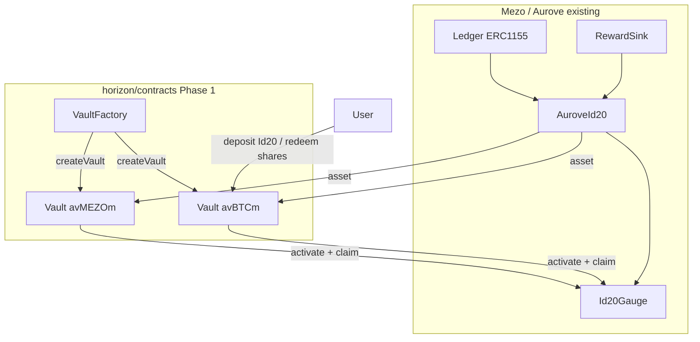
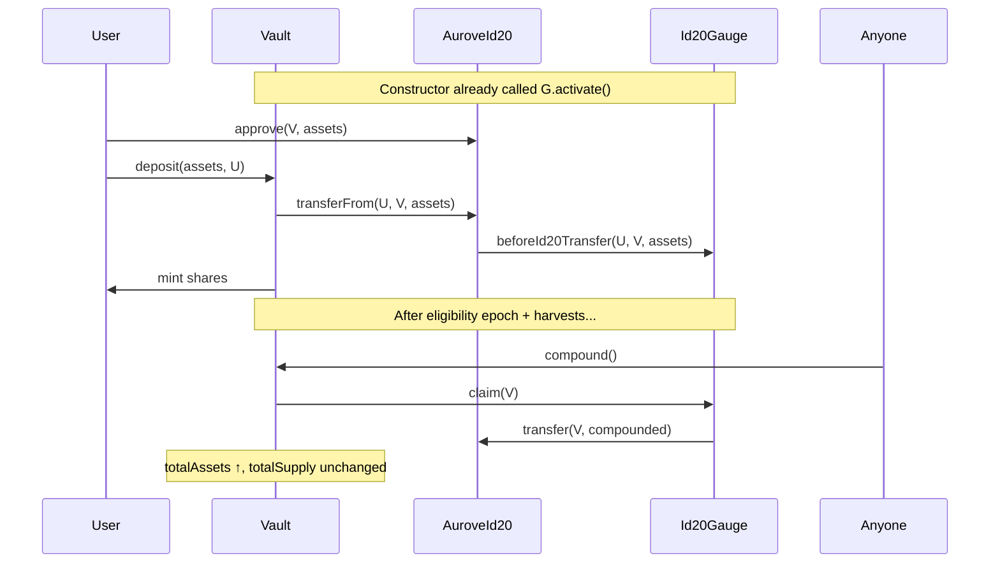

# Horizon ERC-4626 Vault System for Aurove Id20

| Field | Value |
|-------|-------|
| **Author** | TBD |
| **Date** | 2026-10-18 |
| **Status** | Implemented (identifiers: `Vault` / `VaultFactory`; no `Horizon*` type names) |
| **Package** | `@aurove/horizon-contracts` (`horizon/contracts`) |
| **Scope** | Phase 1 — Vault Infrastructure (no Wormhole NTT / Aerodrome) |

---

## Overview

Horizon Phase 1 introduces a factory-based ERC-4626 vault layer over eligible Aurove Id20 ERC-20 wrappers. Each vault accepts exactly one Id20 asset (for example managed `avBTCm` or `avMEZOm`), issues standard ERC-20 vault shares, and compounds the vault’s attributable Id20 gauge rewards into its underlying balance so assets-per-share appreciate without diluting existing shareholders.

This design reuses Aurove’s existing reward pipeline end-to-end—`Ledger.claimRebases` → `RewardSink` → `AuroveId20.claimRewards` → `Id20Gauge`—and does **not** invent a parallel reward system or modify core/id20 contracts. Vaults are ordinary immutable contracts deployed by a factory, matching the Id20 package’s deployment model and keeping share-token logic suitable for later Wormhole NTT and Aerodrome integrations.

---

## Background & Motivation

### Current state

Aurove already provides the liquid stack Horizon builds on:

| Layer | Role | Key contracts |
|-------|------|----------------|
| Mezo Earn | Locked BTC / MEZO → veNFTs | External |
| Core Ledger | 1:1 ERC-1155 tranche units | `packages/core/contracts/Ledger.sol` |
| Core Vault / Manager / Sink | Custody, rebases, ERC1155 reward distribution | `Vault.sol`, `VeNftManager.sol`, `RewardSink.sol`, `InstantRewards.sol` |
| Id20 | 1:1 ERC-1155 → ERC-20 wrap | `packages/id20/src/Id20.sol`, `aurove/AuroveId20.sol` |
| Id20Gauge | Instant Q128 rewards in Id20 for activated holders | `packages/id20/src/Id20Gauge.sol`, `base/RewardsBook.sol` |
| Id20Factory | One immutable wrapper per tranche | `packages/id20/src/aurove/Id20Factory.sol` |

Horizon’s product vision (`horizon/README.md`) extends this stack with ERC-4626 vaults whose shares can later bridge via Wormhole NTT and provide liquidity on Aerodrome. The contracts package (`@aurove/horizon-contracts`) is scaffolded with Foundry + Hardhat mirroring id20 (solc `0.8.28`, viaIR, optimizer runs `200`, OZ `5.4.0`) but currently has no Solidity sources under `src/`.

### Pain points

1. **Id20 is 1:1.** Wrapping does not encode yield appreciation; holders must activate and claim gauge rewards themselves.
2. **No standardized vault share.** Cross-chain DeFi and LP venues expect ERC-4626 / ERC-20 vault shares, not raw Id20 + gauge claims.
3. **Compounding is manual.** Yield exists in the gauge index until claimed; there is no protocol component that claims on behalf of a pooled Id20 position and reinvests into a shared NAV.

### Yield pipeline (must remain authoritative)

```mermaid
flowchart LR
  A["Mezo distributor rebases"] --> B["VeNftManager.claimRebases"]
  B --> C["Vault.accountInventoryGrowth"]
  C --> D["Ledger mints ERC1155 to RewardSink"]
  D --> E["RewardSink.syncRewardFunding / InstantRewards"]
  E --> F["AuroveId20.claimRewards<br/>claimRewardsAndCall(abi.encode(gauge))"]
  F --> G["Id20 minted to Id20Gauge + notifyReward"]
  G --> H["Activated holders accrue Q128 index"]
  H --> I["Id20Gauge.claim(receiver)"]
  I --> J["Vault.compound<br/>receiver = vault"]
  J --> K["Vault Id20 balance ↑<br/>shares unchanged → rate ↑"]
```



Concrete interfaces already in production:

- Upstream harvest (permissionless): `IAuroveId20.claimRewards()` in `packages/id20/src/aurove/AuroveId20.sol`
- Holder claim: `IId20Gauge.claim(address receiver)` in `packages/id20/src/Id20Gauge.sol`
- Activation: `IId20Gauge.activate()` (permanent; required before `claim`)
- Rebase funding (external to Horizon): `ILedger.claimRebases(trancheId, tokenIds)` then sink sync inside claim paths

**Assumption (documented):** Horizon vaults compound **only** Id20 already indexed/claimable on `Id20Gauge`. They do not call Ledger rebases or manage veNFT inventory. Keepers / existing Aurove ops remain responsible for rebase → sink funding → `AuroveId20.claimRewards`.

---

## Goals & Non-Goals

### Goals

1. Deploy one ERC-4626 vault per supported Id20 asset via a factory that prevents duplicates and supports discovery.
2. Preserve Aurove’s 1:1 ERC-1155 ↔ Id20 wrapping model unchanged; vaults sit **above** Id20.
3. Standard ERC-4626 deposit / mint / withdraw / redeem / preview / max\* with OZ rounding and inflation mitigations.
4. Permissionless compounding of the vault’s attributable gauge rewards into vault-held Id20 (assets grow, shares do not).
5. `totalAssets()` reflects **only** Id20 held by the vault—never unclaimed gauge rewards.
6. Modular, gas-efficient Solidity in `@aurove/horizon-contracts` with comprehensive Forge (+ optional Hardhat) tests.
7. Vault shares remain plain ERC-20 suitable for future NTT / Aerodrome (no bridge or DEX code in this phase).

### Non-Goals

- Wormhole NTT, Base deployment, or Aerodrome pool integration (Phases 2–3).
- Modifying `packages/core` or `packages/id20` contracts unless a hard blocker appears (none identified).
- Parallel reward indices, fee switches, pause guardians, or upgradeable vault logic in Phase 1.
- Auto-claiming Ledger rebases or FreeManagedRewards from Horizon vaults.
- Supporting non-AuroveId20 ERC-20s or mixing multiple tranche classes in one vault.
- On-chain APR oracles or share-price TWAP feeds.
- Zap / router that compounds in the same transaction as deposit (Phase 1: separate calls only).

---

## Proposed Design

### High-level architecture



### Package layout

```text
horizon/contracts/
├── src/
│   ├── Vault.sol
│   ├── VaultFactory.sol
│   ├── interfaces/
│   │   ├── IVault.sol
│   │   └── IVaultFactory.sol
│   └── vendor/aurove/interfaces/   # minimal read/claim surfaces only
│       ├── IAuroveId20.sol          # claimRewards, rewardSink() → IId20RewardsSink
│       ├── IId20.sol                # asset(), id() (factory validation)
│       ├── IId20RewardsSink.sol     # id20(), notifyReward, beforeId20Transfer
│       └── IId20Gauge.sol           # activate, claim, accountState (no id20())
├── test/
│   ├── Vault.t.sol
│   ├── VaultFactory.t.sol
│   ├── VaultCompound.t.sol
│   ├── VaultERC4626.t.sol    # extends OZ erc4626-tests
│   ├── invariant/
│   └── mocks/
├── deploy/scripts/
│   ├── 00_factory.ts
│   ├── 01_vaults.ts                 # create avBTCv / avMEZOv over avBTCm / avMEZOm
│   └── 99_verify.ts
└── ...
```

Vendor interfaces are **minimal copies** of the production Id20 surfaces Horizon calls, not path imports into `packages/core` or `packages/id20` source trees, so `@aurove/horizon-contracts` remains independently buildable.

**Interface split (must match `packages/id20`):**

| Interface | Declares | Used by Horizon for |
|-----------|----------|---------------------|
| `IId20RewardsSink` | `id20()`, `notifyReward()`, `beforeId20Transfer()` | Factory back-pointer check; `IAuroveId20.rewardSink()` return type |
| `IId20Gauge` | `activate()`, `claim()`, `accountState()`, … | Vault compounding / activation (**does not** declare `id20()`) |
| `IId20` | `asset()`, `id()`, `unwrap()`, … | Factory validation of wrap config |
| `IAuroveId20` | `rewardSink()`, `claimRewards()`, … | Harvest helper; resolve gauge address |

`Id20Gauge` implements both `IId20RewardsSink` and `IId20Gauge`. Horizon may cast the same address to either interface, but **must not** invent `IId20Gauge.id20()` in a faithful vendor copy.

### Component 1 — `Vault`

**Role:** ERC-4626 vault over one immutable Id20 asset; compounds gauge claims into asset balance.

**Inheritance (proposed):**

```solidity
contract Vault is ERC4626, ReentrancyGuard, IVault {
    // ERC20 name/symbol via ERC20 constructor
    // ERC4626(asset) with OZ virtual shares/assets (_decimalsOffset)
}
```

Use OpenZeppelin `ERC4626` from `lib/openzeppelin-contracts` (already pinned `5.4.0` in the package). Do **not** use upgradeable variants.

#### Construction & gauge activation

```solidity
constructor(
    IERC20 asset_,
    string memory name_,
    string memory symbol_
) ERC20(name_, symbol_) ERC4626(asset_) {
    // rewardSink() returns IId20RewardsSink; Id20Gauge also implements IId20Gauge.
    IId20RewardsSink sink = IAuroveId20(address(asset_)).rewardSink();
    if (address(sink) == address(0)) revert InvalidId20Asset(address(asset_));
    _gauge = IId20Gauge(address(sink));
    // Permanent opt-in so deposits accrue reward weight and compound can claim.
    _gauge.activate();
}
```

**Why activate in the constructor (and how `msg.sender` works):**

- `Id20Gauge.claim` requires the **claiming account** to be activated (`NotInitialized` otherwise).
- In the constructor *body*, `msg.sender` is the **factory/deployer**, not the vault. What makes activation correct is that `_gauge.activate()` is an **external call**: the gauge therefore observes `msg.sender == address(this)` (the vault).
- **Do not** have the factory call `gauge.activate()` itself—that would activate the factory address, not the vault.
- Equivalent safe patterns: call `_gauge.activate()` from the vault constructor (preferred), or a vault self-call such as `Vault(address(this)).ensureActivated()` if activation is ever moved out of the constructor body.
- Zero Id20 balance at activation is fine: later transfers update settled units via `beforeId20Transfer`.
- **Required tests:** after `new Vault(...)` (and after factory `createVault`), assert `gauge.accountState(vault).isActivated == true` and `gauge.accountState(factory).isActivated == false`.

Store `_gauge` as immutable for gas and to avoid trusting a mutable registry.

#### Asset accounting

```solidity
/// @inheritdoc ERC4626
/// @dev Only Id20 held by this vault. Unclaimed Id20Gauge rewards are NOT assets.
function totalAssets() public view override returns (uint256) {
    return IERC20(asset()).balanceOf(address(this));
}
```

This matches the user requirement and OZ’s default. Direct Id20 donations increase `totalAssets` and benefit shareholders (standard ERC-4626 donation semantics); inflation risk is mitigated via virtual shares (below), not by ignoring donations.

#### Inflation / donation attack

- Rely on OZ v5.4 virtual shares/assets via `_decimalsOffset()`.
- **Frozen default:** `_decimalsOffset() == 0` (OZ virtual shares/assets = 1). Offset `0` **raises the cost** of empty-vault donation attacks but does **not** eliminate first-depositor edge cases; OZ documents residual value capture by virtual shares.
- **Mandatory operational seed (deploy scripts, managed vaults):** after creating each managed vault, deposit a non-trivial dust of Id20 (default **`1e12` wei** of the 18-decimal Id20), then **transfer the resulting vault shares** to the fixed dead address:

  `address constant DEAD = 0x000000000000000000000000000000000000dEaD;`

  - **Never** mint/transfer shares to `address(0)` — OZ ERC-20 v5 reverts with `ERC20InvalidReceiver`.
  - **Never** `_burn` the seed shares to create “dead” supply: burning shrinks `totalSupply` while assets remain, which *increases* the exchange rate instead of leaving dilutive dead shares.
  - Dead-address holdings remain in `totalSupply` and dilute inflation attacks as intended.
- **Redeploy-safe / idempotent seed:** hardhat-deploy script re-runs must **not** deposit again if the dead address already holds seed shares. Skip the seed step when `vault.balanceOf(DEAD) > 0` (or `>=` the expected share amount from the `1e12` asset deposit). Vault creation may use `createVault` (hard-fail on duplicate) or `getOrCreateVault` (no-op if present); either way, gate seed on dead-share balance so re-runs do not inflate TVL/`totalSupply`.
- Seed is required for testnet/mainnet managed vault deploy tags; unit tests may skip seed when using mocks with controlled first deposit.

#### ERC-4626 surface

Implement / inherit standard:

| Function | Notes |
|----------|-------|
| `deposit` / `mint` | `SafeERC20.transferFrom` Id20 → vault; mint shares |
| `withdraw` / `redeem` | burn shares; transfer Id20 out |
| `preview*` / `convert*` | OZ Floor/Ceil rounding |
| `maxDeposit` / `maxMint` | `type(uint256).max` unless future caps |
| `maxWithdraw` / `maxRedeem` | based on owner share balance |

Add `nonReentrant` on mutative ERC-4626 entrypoints and on `compound` (defense in depth; Id20 unwrap/gauge paths already guard some flows).

#### Compounding API

```solidity
/// @notice Claims this vault's accrued Id20Gauge rewards to itself.
/// @dev Permissionless. Increases totalAssets without minting shares.
///      Does not call AuroveId20.claimRewards or Ledger.claimRebases.
/// @return compounded Amount of Id20 transferred from the gauge to this vault.
function compound() external nonReentrant returns (uint256 compounded);

/// @notice Optional helper: attempt upstream Id20 harvest, then compound.
/// @dev Upstream harvest benefits all eligible Id20 holders; compound pulls only
///      this vault's claimable amount. Upstream step may no-op / skip on revert.
function harvestAndCompound()
    external
    nonReentrant
    returns (uint256 harvested, uint256 compounded);
```

**Normative compounding behavior (frozen for PR1 ABI):**

| Function | Zero vault claimable | Upstream harvest failure |
|----------|----------------------|---------------------------|
| `compound()` | Revert `NoRewardsToCompound` | N/A (does not harvest) |
| `harvestAndCompound()` | Return `(harvested, 0)` — **do not** call `claim`, **do not** revert solely for zero claimable | Catch; treat as `harvested = 0`, continue |

**`compound` implementation sketch:**

```solidity
function compound() public nonReentrant returns (uint256 compounded) {
    uint256 claimable = _gauge.accountState(address(this)).claimableReward;
    if (claimable == 0) revert NoRewardsToCompound();

    // msg.sender inside claim is this vault (external call from vault code).
    compounded = _gauge.claim(address(this));
    // Id20 is not fee-on-transfer; gauge transfers exactly `claimed`.
    // Optional defense-in-depth balance-delta check may be omitted; if kept,
    // mocks must transfer the same amount they return (see CompoundAmountMismatch).
    emit Compounded(msg.sender, compounded);
}
```

**`harvestAndCompound` implementation sketch (must not delegate to `compound()`):**

```solidity
function harvestAndCompound()
    public
    nonReentrant
    returns (uint256 harvested, uint256 compounded)
{
    try IAuroveId20(asset()).claimRewards() returns (uint256 h) {
        harvested = h;
    } catch {
        harvested = 0;
    }

    uint256 claimable = _gauge.accountState(address(this)).claimableReward;
    if (claimable == 0) {
        return (harvested, 0); // tolerant keeper helper
    }

    compounded = _gauge.claim(address(this));
    emit Compounded(msg.sender, compounded);
}
```

**Do not** implement `harvestAndCompound` as `harvest(); compound();` — that would reintroduce `NoRewardsToCompound` after a successful upstream harvest when the vault still has no eligible weight.

#### Gauge interaction semantics (critical)

Horizon vaults inherit Id20Gauge transfer/credit rules:

| Event | Effect on vault reward weight |
|-------|-------------------------------|
| Deposit from activated user | Settled units move with eligibility vintage |
| Deposit from non-activated user | Vault receives settled units; eligibility starts **next weekly epoch** |
| `compound` payout to activated vault | New units eligible from **next** epoch (same as any active claim receiver) |
| Withdraw to user | Weight moves out per gauge rules |

**Do not** attempt to settle credit for third parties inside the vault. Document that protocols depositing Id20 on behalf of users should understand gauge activation/credit if they also hold Id20 outside the vault. For pure ERC-4626 users who only hold vault shares, gauge credit is an implementation detail of the vault address.

#### Direct transfers / credit edge cases

ERC-4626 `deposit`/`mint` pull Id20 via `transferFrom`, but anyone may also **donate** Id20 with a plain `transfer` to the vault. Gauge hooks still run:

- **Activated donor → vault:** settled units (and eligibility vintage) move to the vault; `totalAssets` increases (shareholders benefit).
- **Non-activated donor → vault:** residual can become vault settled units (next-epoch eligible) **or**, if the donor held **unsettled credit**, credit classification can move onto the vault per `LoanBook` / `_beforeMoveFromNonActivated`.
- The vault **never** calls `settleCredit`. Credit sitting on the vault does not prevent ERC-4626 accounting (`totalAssets` is still `balanceOf`), but gauge burns/direct gauge deposits of credit-classified balance revert with `UnsettledCredit`. Normal vault **withdraw/redeem** uses ordinary Id20 transfers out of an activated vault and follows `_beforeMoveFromActivated` (credit moves first, then settled units).
- **Required tests:** (1) activated donation increases assets and share price; (2) non-activated transfer that issues/moves credit onto the vault; (3) withdraw/redeem after compound still succeeds; (4) vault does not unexpectedly hit `UnsettledCredit` on happy-path withdraw.

#### Views for integrators

```solidity
function gauge() external view returns (IId20Gauge);
function claimableRewards() external view returns (uint256); // gauge.accountState(this).claimableReward
function previewCompound() external view returns (uint256);  // alias of claimableRewards
```

Unclaimed rewards **must not** be added into `convertToAssets` / `totalAssets`.

#### Access control

- **No owner** on the vault **or** factory in Phase 1 (matches Id20 immutability ethos).
- `compound` / `harvestAndCompound` are permissionless (normative behaviors above).
- No pause. If emergency controls are needed later, they belong in a separate governed wrapper—not in the share token’s base logic—because NTT will treat shares as canonical supply.

### Component 2 — `VaultFactory`

**Role:** Deploy and register at most one vault per Id20 asset; discovery helpers; events.

#### Proxy evaluation (decision)

| Option | Pros | Cons | Fit |
|--------|------|------|-----|
| **A. Immutable `new Vault(...)`** (like `Id20Factory`) | Simplest; no initializer risk; matches id20; ideal for NTT trust in share logic | Higher deploy gas vs clones | **Selected** |
| B. EIP-1167 Clones (+ initialize) | Cheaper deploy | Initializer front-run risk; diverges from id20; upgrade confusion | Rejected for Phase 1 |
| C. Beacon proxies | One upgrade for all vaults | Upgradeability of share accounting is a major NTT / LP trust hazard; core uses beacons for managers/sinks, **id20 explicitly does not** | Rejected |

**Decision:** Factory uses ordinary immutable deployments (`new Vault(...)`), matching Id20’s **no-proxy / immutable instance** model. CREATE2 is optional later for deterministic addresses; not required for Phase 1.

**API divergence from `Id20Factory` (intentional):**

| Id20Factory | VaultFactory |
|-------------|---------------------|
| `createId20` is **idempotent** (returns existing wrapper if present) | `createVault` **reverts** `VaultAlreadyExists` if a vault already exists for `asset` |
| `getOrCreateId20` also idempotent | `getOrCreateVault` is the **Id20-like idempotent** path (return existing or create) |

Deploy scripts and integrators that copy id20 patterns should call **`getOrCreateVault`** when they want idempotent behavior, and **`createVault`** when they want a hard fail on duplicates (clearer for one-shot launch scripts). Do not describe `createVault` as identical to `createId20`. When `getOrCreateVault` returns an existing vault, **`name` / `symbol` arguments are ignored**.

#### Interface

```solidity
interface IVaultFactory {
    error ZeroAddress();
    error VaultAlreadyExists(address asset, address vault);
    error InvalidId20Asset(address asset);

    event VaultCreated(
        address indexed asset,
        address indexed vault,
        address indexed gauge,
        string name,
        string symbol
    );

    function getVault(address asset) external view returns (address vault);
    function allVaultsLength() external view returns (uint256);
    function allVaults(uint256 index) external view returns (address vault);
    function isVault(address account) external view returns (bool);

    function createVault(address asset, string calldata name, string calldata symbol)
        external
        returns (address vault);

    function getOrCreateVault(address asset, string calldata name, string calldata symbol)
        external
        returns (address vault);
}
```

#### Validation on create (mandatory — Phase 1)

Permissionless create requires **concrete** ABI-surface checks (best-effort anti-spoof, **not** an allowlist). Revert `InvalidId20Asset` unless **all** of the following succeed:

1. `asset != address(0)`.
2. No vault already registered for `asset` (`createVault` path); `getOrCreateVault` skips create when present.
3. `sink = IAuroveId20(asset).rewardSink()` returns non-zero (`IId20RewardsSink`).
4. `address(IId20RewardsSink(sink).id20()) == asset` — **`id20()` is on `IId20RewardsSink`, not on `IId20Gauge`** (production ABI in `packages/id20/src/interfaces/IId20RewardsSink.sol`; `Id20Gauge` implements it).
5. `IId20(asset).asset() != address(0)` (ERC1155 collection configured).
6. `IId20(asset).id() != 0` (tranche id configured; managed IDs are non-zero).

Acceptance bar: these checks stop trivial spoof ERC-20s that only fake `rewardSink()` from polluting `allVaults` / `getVault`. They do **not** cryptographically prove the asset is a canonical Aurove deployment—deploy scripts still pin known mainnet/testnet Id20 addresses for managed vaults.

Then: deploy `Vault`; record `mapping(address => address)` + enumerable `address[]`; emit `VaultCreated`.

#### Creation permissions (frozen)

**Permissionless** `createVault` / `getOrCreateVault` (Id20Factory spirit). No `Ownable` on the factory in Phase 1. Deploy scripts still explicitly create the two managed vaults and run the mandatory **idempotent** dead-share seed.

**`getOrCreateVault` name/symbol:** if a vault already exists for `asset`, return that address and **ignore** the caller-supplied `name` / `symbol` calldata. Share metadata is fixed at construction and cannot be “applied” on a later getOrCreate call (same practical behavior as id20’s idempotent create returning an existing wrapper).

#### Naming convention (deploy script)

| Id20 (underlying) | Share name | Symbol |
|-------------------|------------|--------|
| avBTCm (`0x010004`) | avBTC Vault | avBTCv |
| avMEZOm (`0x0200d0`) | avMEZO Vault | avMEZOv |

Share tickers **`avBTCv` / `avMEZOv`** are final for Phase 1 (vault share symbols use a `v` suffix; underlying Id20 assets remain `avBTCm` / `avMEZOm`).

Mainnet Id20 references (from `packages/id20/deployments/mainnet`):

- Factory: `0xf7B7e122Ce45b48b53A8452188461bbDd115b935`
- avBTCmId20: `0xf333171788dE7005695b2E8FB9cAE97Ba9c4dD7a`
- avMEZOmId20: `0xb894b11A78B762c82Cb095148F5BC11DC93C3560`

### Deposit / withdraw / compound sequences



### Storage footprint (vault)

| Slot / immutable | Purpose |
|------------------|---------|
| ERC20 balances / supply | Share accounting |
| ERC4626 `_asset`, decimals cache | Underlying Id20 |
| `IId20Gauge private immutable _gauge` | Claim target |
| ReentrancyGuard status | Guard |

No reward index storage on the vault—gauge remains source of truth.

---

## API / Interface Changes

### New interfaces (Horizon only)

No changes to core or id20 ABIs. Horizon adds:

**`IVault`** — ERC-4626 + `compound`, `harvestAndCompound`, `gauge`, `claimableRewards`, `Compounded` event, errors (`NoRewardsToCompound`, `InvalidId20Asset`). Optional `CompoundAmountMismatch` only if the balance-delta assert is kept.

**`IVaultFactory`** — as above (`VaultAlreadyExists` on `createVault` only; `getOrCreateVault` is idempotent).

### Integrator checklist

- Treat vault shares as standard ERC-20 / ERC-4626.
- Discover vault via `factory.getVault(id20)`.
- For idempotent creation (id20-script style), call `getOrCreateVault` (existing vault → return it; ignore `name`/`symbol`); use `createVault` when a duplicate should hard-fail.
- Do **not** expect `totalAssets` to include pending gauge rewards; call `claimableRewards` / `previewCompound` separately for yield UI.
- Keepers: `Ledger.claimRebases` → `AuroveId20.claimRewards` → `Vault.compound` (or `harvestAndCompound` when a soft no-op on zero claimable is desired).
- TypeChain: prefer generated factories per root `AGENTS.md` (e.g. `Vault__factory.connect`).

---

## Data Model Changes

- No database / off-chain schema in Phase 1 beyond hardhat-deploy JSON under `horizon/contracts/deployments/{network}/`.
- On-chain: factory registry mappings only.
- No migrations; greenfield package.
- Optional subgraph later indexing `VaultCreated`, ERC-4626 `Deposit`/`Withdraw`, and `Compounded`.

---

## Alternatives Considered

### 1. Beacon-upgradeable vaults (rejected)

**Idea:** Mirror core’s `UpgradeableBeacon` + `BeaconProxy` for managers/sinks.

**Trade-offs:** Enables bugfix without remigration, but makes share accounting upgradeable—poor fit for NTT canonical supply and Aerodrome LPs. Id20 deliberately avoided proxies. Rejected for Phase 1.

### 2. Vault claims upstream RewardSink directly (rejected)

**Idea:** Bypass Id20Gauge; have vault hold ERC1155 or call sink as Id20.

**Trade-offs:** Breaks 1:1 wrap model, duplicates reward accounting, fights `AuroveId20` harvest path (`claimRewardsAndCall` → gauge mint). Rejected; compound must use `Id20Gauge.claim`.

### 3. Count claimable rewards inside `totalAssets` (rejected)

**Idea:** `totalAssets = balance + claimableRewards` for “fair” share price between compounds.

**Trade-offs:** Violates explicit requirement; makes share price depend on view-accrual and epoch math; enables gaming around claim timing; diverges from OZ ERC4626. Rejected. Off-chain UIs may show “NAV if compounded” using `previewCompound`.

### 4. Minimal proxies with immutable args (deferred)

**Idea:** OZ `Clones.cloneWithImmutableArgs` for cheaper vault deploys.

**Trade-offs:** Lower gas, but initializer/clone complexity and weaker alignment with Id20. Revisit only if many vaults are required and deploy costs dominate.

### 5. Auto-compound on every deposit/withdraw (rejected for v1)

**Idea:** Hook `_deposit`/`_withdraw` to always `compound`.

**Trade-offs:** Unpredictable gas, revert coupling to gauge `NoRewards`, worse UX. Prefer explicit permissionless `compound` + optional router later.

---

## Security & Privacy Considerations

### Threat model

| Risk | Severity | Mitigation |
|------|----------|------------|
| ERC-4626 inflation / donation attack on empty vault | High | `_decimalsOffset == 0` virtual shares **plus mandatory** dead-share seed at `0x…dEaD`; document slippage checks |
| Uninitialized clone / proxy takeover | High | N/A—immutable constructors only |
| Double-counting unclaimed rewards in NAV | High | `totalAssets` = balance only |
| Reentrancy via ERC777-like hooks / gauge callbacks | Medium | `nonReentrant` on vault mutators; Id20 is standard ERC-20 + guarded gauge |
| Gauge credit trapping (activated→inactive patterns) | Medium | Vault permanently activated; no deactivate; tests for donation/credit/withdraw |
| Spoof ERC-20 registered as “Id20” | Medium | Mandatory multi-check ABI validation; managed deploys pin known addresses |
| Keeper griefing `compound` when claimable is dust | Low | Strict revert on zero for `compound`; `harvestAndCompound` soft-returns; bots use views |
| Share token upgrade / admin rug | High (future) | No vault/factory owner/upgrade in Phase 1 |
| Front-run deposit around compound | Low–Med | Same as any ERC-4626; users use `deposit` with off-chain min-shares checks (router later) |
| Mis-activated factory instead of vault | Medium | External `activate` from vault constructor; explicit tests |

### Permissions summary

| Action | Who |
|--------|-----|
| `createVault` / `getOrCreateVault` | Anyone (permissionless; mandatory Id20 ABI validation) |
| `deposit` / `mint` / `withdraw` / `redeem` | Token holders / approved spenders |
| `compound` / `harvestAndCompound` | Anyone |
| Gauge `activate` | Vault constructor external call only (once; activates vault, not factory) |
| Ledger rebase / Id20 harvest | Existing permissionless Aurove paths (external) |

### Privacy

On-chain balances and claims are public; no additional PII.

---

## Observability

### Events

- Factory: `VaultCreated(asset, vault, gauge, name, symbol)`
- Vault: OZ ERC-4626 `Deposit` / `Withdraw` (+ ERC-20 `Transfer`)
- Vault: `Compounded(address indexed caller, uint256 amount)`
- Upstream tracing (index both layers if building keepers/indexers):
  - Id20: `IAuroveId20.RewardsHarvested`
  - Gauge-facing: `IId20Gauge.RewardClaimed` / `IId20Gauge.RewardNotified`
  - RewardsBook (emitted from the same gauge contract): `RewardsFunded` / `RewardsClaimed`
  - Prefer at least `RewardClaimed` (gauge) and optionally `RewardsFunded` (book) so a single-name indexer does not miss funding vs payout

### Metrics (off-chain)

- TVL per vault: `totalAssets()` × Id20/Mezo price
- Exchange rate: `convertToAssets(1e18)`
- Claimable lag: `claimableRewards()` / `totalAssets`
- Compound frequency and amounts from `Compounded`
- Alerts: factory `VaultCreated` for unexpected assets; exchange rate discontinuities; failed keeper harvest pipelines

### Logging

Forge/Hardhat tests and deploy scripts log addresses consistently with id20 (`hre.deployments.log`). No on-chain debug logging.

---

## Rollout Plan

### Stage 0 — Design approval (this document)

No contract code merged until design + PR plan approved.

### Stage 1 — Testnet

1. Deploy `VaultFactory` on Mezo testnet.
2. Prefer `createVault` for first-shot managed tags (hard-fail on duplicate); `getOrCreateVault` is fine for re-entrant scripts.
3. **Mandatory idempotent seed:** if `vault.balanceOf(DEAD) == 0`, deposit `1e12` Id20 wei and transfer shares to `0x…dEaD`; otherwise skip.
4. Run Forge fork tests against live gauge/Id20.
5. Keeper dry-run: rebase → `claimRewards` → `compound` / `harvestAndCompound`.

### Stage 2 — Mainnet soft launch

1. Deploy factory; create two managed vaults only; run the same **idempotent** dead-share seed (skip if `DEAD` already holds shares).
2. Gate mainnet deploy tags on PR suite including ERC-4626 conformance + fork tests (see PR plan).
3. No NTT / Aerodrome yet; shares transferable on Mezo only.
4. Monitor compound bots and exchange-rate monotonicity (absent donations/withdrawals).

### Feature flags

None on-chain. Operational “flag” = whether deploy scripts create a vault for a given Id20.

### Rollback

Immutable deployments cannot be upgraded. Rollback = deprecate UI routing and optionally deploy a new factory/vault if a critical bug appears (migrate liquidity socially). This is an accepted trade-off vs upgradeable beacons.

---

## Testing Strategy

### Unit / integration (Forge)

| Suite | Coverage |
|-------|----------|
| `VaultFactory.t.sol` | create, `VaultAlreadyExists`, getOrCreate idempotency (ignore name/symbol), enumeration, `IId20RewardsSink.id20` validation failures |
| `Vault.t.sol` | deposit/mint/withdraw/redeem, rounding, zero amounts, reentrancy; constructor activation vs factory not activated |
| `VaultCompound.t.sol` | `compound` reverts on zero; `harvestAndCompound` returns `(h, 0)`; harvest → notify → claim → rate ↑ |
| Donation / credit | Activated donation; non-activated credit donation; withdraw after compound |
| Multi-vault | Two assets side-by-side; no cross-contamination |
| Gauge edge | Deposit before/after epoch boundary; compound creates next-epoch units |

### ERC-4626 property tests

Extend OZ’s bundled `lib/openzeppelin-contracts/lib/erc4626-tests` (`ERC4626Test`) with a Horizon vault setup, supplying mint/burn shims on a mock Id20 **or** fork-based setup overrides.

### Invariants

- `totalAssets() == id20.balanceOf(vault)`
- `totalAssets()` does not decrease on `compound` (strictly increases when compounded > 0)
- `sum(user shares) == totalSupply`
- Convert round-trips within OZ Floor/Ceil tolerances
- Factory: bijection asset ↔ vault; `isVault` consistent

### Fork tests

Mirror `packages/id20/test/fork/AuroveId20Harvest.t.sol`: fork Mezo testnet, use deployed Id20/gauge, deposit into Horizon vault, warp epoch, synthetic/notify path, `compound`, assert share appreciation.

### Hardhat

Optional deploy-script smoke tests under `test/hardhat/` using TypeChain factories (`VaultFactory__factory`, etc.) per `AGENTS.md`.

---

## Open Questions

Phase-1 engineering defaults are **frozen** (see Key Decisions 11–15). Former product questions:

1. **Share branding — Resolved:** Vault share symbols are **`avBTCv` / `avMEZOv`**. Underlying Id20 assets remain production `avBTCm` / `avMEZOm`. Share names: “avBTC Vault” / “avMEZO Vault”.
2. **Zap / same-tx compound — Resolved:** Phase 1 keeps **separate calls only**. Deposit and `compound` / `harvestAndCompound` are not combined in one transaction; Zap same-tx compound is out of Phase 1 scope (future non-goal until a later periphery design).

---

## Key Decisions

1. **Immutable vault + factory deployments (no beacon / no clones).** Matches Id20’s no-proxy model; minimizes initializer risk; keeps share logic trustworthy for future NTT. Core’s beacon pattern is intentionally **not** copied here.

2. **One vault per Id20 asset, registered in factory.** Prevents fragmented liquidity and duplicate NAVs for the same underlying. **`createVault` reverts on duplicate; `getOrCreateVault` is the idempotent Id20-like path** (intentional API divergence from `Id20Factory.createId20`).

3. **Underlying asset is Id20 ERC-20 only; ERC-1155 1:1 wrap untouched.** Horizon sits strictly above Id20; no changes to Ledger/Id20 wrap invariants.

4. **Compounding = `Id20Gauge.claim(vault)` only; unclaimed rewards excluded from `totalAssets`.** Uses real gauge accounting (`accountState`, `claim`, Q128 index). No parallel reward system. NAV reflects Id20 **balance** solely.

5. **Vault self-activates via an external `activate()` call in its constructor.** The factory/deployer is `msg.sender` in the constructor body; the gauge sees `msg.sender == vault` because the call is external. Never activate from the factory directly.

6. **Permissionless `compound` / `harvestAndCompound`; no vault owner/pause.** Yield claiming stays aligned with Aurove’s permissionless harvest ethos.

7. **OpenZeppelin ERC4626 (v5.4) with `_decimalsOffset() == 0` plus mandatory dead-share seed.** Virtual shares raise attack cost but do not fully eliminate empty-vault edge cases; deploy scripts must seed and transfer shares to `0x…dEaD` (never `address(0)`, never burn seed shares).

8. **Vendor minimal interfaces inside horizon-contracts** include `IAuroveId20`, `IId20`, `IId20RewardsSink`, and `IId20Gauge`. Independent builds without compiling core/id20 sources.

9. **Do not modify Aurove core or id20 contracts.** Call surfaces: `IAuroveId20.claimRewards` / `rewardSink`; **`IId20RewardsSink.id20`** (not `IId20Gauge`); `IId20Gauge.activate` / `claim` / `accountState`; `IId20.asset` / `id`.

10. **Out of scope: Wormhole NTT and Aerodrome.** Shares are plain ERC-20/4626 so those phases can attach later without redesigning vault accounting.

11. **Factory is permissionless** with mandatory multi-check Id20 ABI validation: `rewardSink() != 0`, **`IId20RewardsSink(sink).id20() == asset`**, `IId20.asset() != 0`, `IId20.id() != 0`. Best-effort anti-spoof, not a whitelist.

12. **`compound()` reverts `NoRewardsToCompound` when claimable == 0;** **`harvestAndCompound()` returns `(harvested, 0)` without calling `claim` and without reverting solely for zero vault claimable.** Helper must not call `compound()` internally.

13. **Managed vault seed:** deposit **`1e12`** Id20 wei, transfer shares to **`0x000000000000000000000000000000000000dEaD`**. Required for tagged testnet/mainnet managed deploys. **Idempotent:** skip if `vault.balanceOf(DEAD) > 0`.

14. **Share symbols are `avBTCv` / `avMEZOv`** for managed vaults (no trailing `m`; underlying Id20 remains `avBTCm` / `avMEZOm`).

15. **Optional `CompoundAmountMismatch` balance-delta assert is not required** in the normative spec; prefer trusting `claim`’s return value. If an implementer keeps the assert, mocks must transfer exactly the returned amount.

---

## References

Paths below are **workspace-root relative** (aurove monorepo). When this design is copied into `horizon/contracts/docs/vault-design.md` (docs PR), rewrite links to be relative from that final location (e.g. `../../../packages/id20/...` or keep root-relative prose paths).

- Product vision: `horizon/README.md`
- Package scaffold: `horizon/contracts/README.md`
- Id20 harvest + gauge: `packages/id20/README.md`, `packages/id20/src/aurove/AuroveId20.sol`, `packages/id20/src/Id20Gauge.sol`, `packages/id20/src/base/RewardsBook.sol`, `packages/id20/src/interfaces/IId20RewardsSink.sol` (`id20()`), `IId20Gauge.sol` (no `id20()`)
- Id20 factory pattern: `packages/id20/src/aurove/Id20Factory.sol` (note idempotent `createId20` vs Horizon `createVault`)
- Core reward sink / rebases: `packages/core/contracts/tranche/RewardSink.sol`, `Ledger.claimRebases`, `InstantRewards.sol`
- OZ ERC-4626: `horizon/contracts/lib/openzeppelin-contracts/contracts/token/ERC20/extensions/ERC4626.sol`
- OZ ERC-4626 property tests: `horizon/contracts/lib/openzeppelin-contracts/lib/erc4626-tests/`
- Agent convention: root `AGENTS.md` (prefer TypeChain factories)
- EIP-4626: https://eips.ethereum.org/EIPS/eip-4626

---

## Assumptions About Aurove Rewards (explicit)

1. Inventory growth is minted to `RewardSink` via `Ledger.claimRebases(trancheId, tokenIds)` → `accountInventoryGrowth` → `_mint(rewardSink, ...)`.
2. `AuroveId20.claimRewards` is the canonical bridge from ERC1155 sink claims into Id20 gauge inventory (`claimRewardsAndCall(abi.encode(gauge))` + `notifyReward`).
3. Only **activated** addresses accrue and `claim` gauge rewards; eligibility for newly created weight starts at the **next weekly epoch** (`block.timestamp / 1 weeks`).
4. Horizon vaults earn as ordinary activated Id20 holders proportional to eligible weight; they do not receive special sink privileges.
5. Direct Id20 transfers to the gauge are donations handled by `notifyReward`; vault compounding never treats unclaimed index accrual as ERC-4626 assets.
6. Direct Id20 transfers **to the vault** may move unsettled credit under gauge rules; the vault does not call `settleCredit`. Happy-path ERC-4626 withdraw from an activated vault remains the supported exit.
7. Current production focus is managed tranches `0x010004` (avBTCm) and `0x0200d0` (avMEZOm); factory may still accept any address passing mandatory ABI validation.

---

## Risks (summary)

| ID | Risk | Severity | Mitigation |
|----|------|----------|------------|
| R1 | Empty-vault inflation attack | High | `_decimalsOffset == 0` virtual shares **plus mandatory** `1e12` seed shares held at `0x…dEaD` |
| R2 | Users expect unclaimed yield in share price | Med | Docs + `previewCompound` view; UI education |
| R3 | Weekly eligibility delay after deposit/compound | Med | Document inherited gauge semantics |
| R4 | Immutable bug requires liquidity migration | Med | Thorough tests + fork coverage before mainnet deploy tags |
| R5 | Keeper pipeline stalls (no rebase/harvest) | Med | External monitoring; tolerant `harvestAndCompound` |
| R6 | Spoof ERC-20 registered as Id20 | Low–Med | Mandatory ABI validation incl. `IId20RewardsSink.id20()==asset`; managed deploys pin known addresses |
| R7 | Factory accidentally activated instead of vault | Med | Constructor external `activate`; tests assert vault activated / factory not |

---

## PR Plan

Incremental PRs against `horizon/contracts` (`@aurove/horizon-contracts`). No core/id20 source changes. Buildathon note: five PRs below; if review bandwidth is tight, PR1 already combines interfaces+vault (formerly separate), and PR3 combines conformance+fork suites.

### PR 1 — Interfaces, vendor ABIs, and `Vault`

- **Title:** `feat(contracts): Vault ERC-4626 over Id20 with gauge compound`
- **Files/components:** `src/interfaces/*`, `src/vendor/aurove/interfaces/{IAuroveId20,IId20,IId20RewardsSink,IId20Gauge}.sol`, `src/Vault.sol`, mocks, `test/Vault.t.sol`, `test/VaultCompound.t.sol`
- **Dependencies:** None
- **Description:** Vendor copies must place `id20()` on `IId20RewardsSink` only. Lock frozen compounding ABI (`compound` strict / `harvestAndCompound` tolerant). Implement immutable vault with OZ `ERC4626`, `_decimalsOffset == 0`, constructor external `activate()` after casting `rewardSink()` → `IId20Gauge`. Deploy vaults in tests with raw `new Vault(...)` and **assert constructor activation regression**: `accountState(vault).isActivated` and factory/deployer not activated. Cover deposit/withdraw, donation/credit edges, and normative compound behaviors.

### PR 2 — `VaultFactory`

- **Title:** `feat(contracts): VaultFactory with one-vault-per-asset registry`
- **Files/components:** `src/VaultFactory.sol`, `test/VaultFactory.t.sol`
- **Dependencies:** PR 1
- **Description:** Permissionless `createVault` (revert `VaultAlreadyExists`) and idempotent `getOrCreateVault` (ignore `name`/`symbol` when existing). Mandatory ABI validation via `IId20RewardsSink.id20()==asset` (not `IId20Gauge.id20`), plus `IId20.asset/id`. Enumerable discovery + `VaultCreated`. Re-assert activation of created vaults vs factory.

### PR 3 — ERC-4626 conformance, invariants, and Mezo fork harvest tests

- **Title:** `test(contracts): ERC-4626 properties, invariants, and Id20 harvest fork coverage`
- **Files/components:** `test/VaultERC4626.t.sol`, `test/invariant/*`, `test/fork/VaultHarvest.t.sol`, fork fixtures
- **Dependencies:** PR 1–2
- **Description:** OZ erc4626-tests harness; balance/supply/compound invariants; Mezo fork path rebase/harvest → `compound` / `harvestAndCompound` with exchange-rate appreciation. This suite **gates** mainnet deploy tags.

### PR 4 — Deploy scripts + managed vault creation + dead-share seed

- **Title:** `chore(contracts): hardhat-deploy factory, managed vaults, and dEaD share seed`
- **Files/components:** `deploy/scripts/00_factory.ts`, `01_vaults.ts`, `99_verify.ts`, deploy utils, env example
- **Dependencies:** PR 2 **and** PR 3 (do not ship managed mainnet/testnet tags before conformance + fork coverage)
- **Description:** Deploy factory; prefer `createVault` for first-shot managed tags (`getOrCreateVault` OK for re-runs); **mandatory idempotent seed**—deposit `1e12` Id20 and transfer shares to `0x…dEaD` only if `vault.balanceOf(DEAD) == 0`; verify on Blockscout/Sourcify. Use TypeChain factories per `AGENTS.md`.

### PR 5 — Package docs pass

- **Title:** `docs(contracts): vault architecture, compound flow, and integrator checklist`
- **Files/components:** `horizon/contracts/README.md`; copy this design to `horizon/contracts/docs/vault-design.md` with **repo-relative links fixed** for that location
- **Dependencies:** PR 1–4
- **Description:** Implementation-aligned docs: create vs getOrCreate (ignore name/symbol), idempotent seed procedure, `IId20RewardsSink.id20` validation, compound vs harvestAndCompound, gauge credit notes, NTT/Aerodrome out of scope.

---

*End of design document.*

